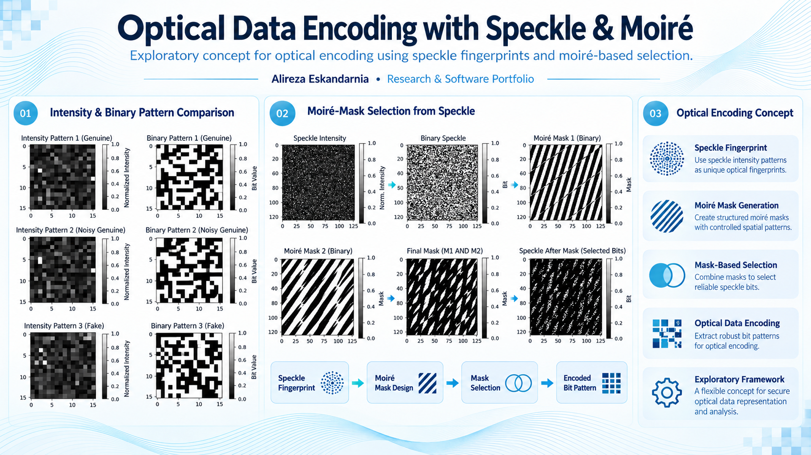

<!-- Academic and software portfolio showcase. No source code is included. -->
# Optical Data Encoding with Speckle Interference & Moiré Patterns

**Optical Information Processing · Laser Speckle · Moiré Patterns · Numerical Simulation**

An exploratory numerical concept investigating how **speckle intensity patterns** and additional **moiré-based masks** could be combined for selective representation of optical information.

## Research Concept

The illustrations cover: (1) speckle intensity and binary-pattern comparisons; (2) the formation and combination of structured moiré masks; and (3) the selection of masked speckle-pattern elements for further analysis.

The work extends speckle-based optical measurement concepts toward optical pattern representation and selective information recovery.

## Scope and Limitations

- **Exploratory simulation / concept**, not a finished encryption product
- Example comparisons are visual demonstrations, not proof of authentication performance
- No independent cryptographic security, reliability, or robustness claims are made
- Source code, private data, and detailed validation results are not included

**Research keywords:** Optical encoding, speckle fingerprints, moiré masks, optical data representation, numerical imaging.

---

**Researcher:** Alireza Eskandarnia  
[GitHub](https://github.com/aalirezaaes) · [ORCID](https://orcid.org/0009-0009-2584-9063) · [LinkedIn](https://www.linkedin.com/in/alireza-eskandarnia/)

**Availability:** Portfolio documentation and selected visual material only. Source code and datasets are not included. No open-source license is granted by this repository.

*Note: Graphics in this showcase include AI-enhanced presentation images. Verify technical labels, numerical values, and scientific plots against original research files before reusing them in publications or formal scientific claims.*
